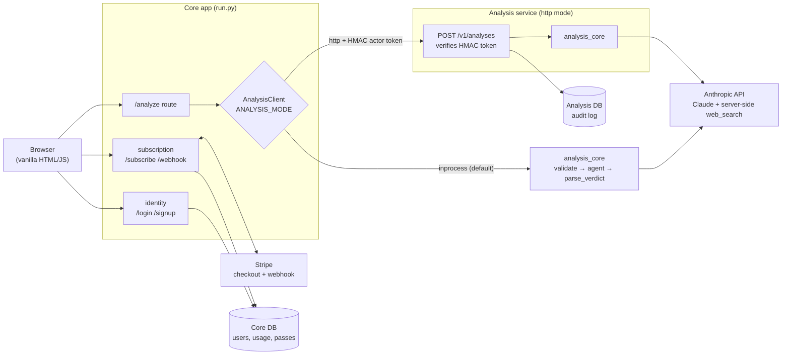

# PPR Fantasy Football Draft Consultant

An AI-powered draft assistant that researches players in real time and delivers instant Draft/Pass verdicts during your fantasy football draft.

Built with Claude Opus 4.7 and live web search — type a player name, get a risk score, recommendation, and one-sentence justification in seconds.

    

<p align="center">
  
</p>

---

## How it works

1. You enter a player name in the web UI
2. An in-house **machine learning model** (scikit-learn) projects the player's PPR points per game for the season from past stats, if it knows the player
3. The agent autonomously searches for their PPR projections for the current season, ADP, recent news, and injury history
4. Claude weighs the model's projection against what it found and returns a structured verdict:
   - **Risk Score** — 1–10 (1 = zero risk, 10 = extreme risk)
   - **Verdict** — Draft or Pass
   - **Reason** — One sentence focused on value over ADP

The agent uses Claude's server-side `web_search` tool, meaning Anthropic executes the searches automatically — no third-party search API needed.

---

## Projection model (machine learning)

A gradient-boosted regression model predicts each player's **next-season PPR points per game**
from his past stats. It gives Claude a stats-based anchor, and the result card shows it next to the verdict.

| | |
|---|---|
| **Data** | [nflverse](https://github.com/nflverse/nflverse-data) regular-season player stats, 2012–2025 (CC-BY 4.0) |
| **Features** | Last season's PPR points per game and games played, the season before, per-game usage (targets, carries, receptions, yards, TDs, EPA), target share, air-yards share, WOPR, age, experience, draft round, position |
| **Label** | PPR points per game the following season (players with at least 4 games in both seasons) |
| **Split** | By season, never random: train on target seasons 2013–2023, choose the model on 2024, score once on 2025 |
| **Model** | `HistGradientBoostingRegressor` (absolute-error loss), chosen over 3 Ridge regression settings and 7 other gradient-boosting settings by validation MAE |

**Held-out 2025 season** (371 players):

| | MAE (pts/game) | Spearman rank correlation |
|---|---|---|
| Model | **2.393** | **0.834** |
| Baseline: same as last season | 2.685 | 0.813 |
| Model, fantasy-relevant players (≥ 10 PPG last season) | **2.881** | **0.658** |
| Baseline, fantasy-relevant players | 3.561 | 0.55 |

That is **10.9% lower error** than the baseline overall and **19.1% lower** for
fantasy-relevant players. Full per-position results: [`ml/reports/REPORT.md`](ml/reports/REPORT.md).

**How it is served.** `python -m ml.train` refits the chosen model on every season and exports one
joblib artifact (`analysis_core/artifacts/ppr_projection.joblib`) with the estimator, the feature order,
and the latest season's feature rows. The services load it once and look players up by normalized name,
so serving needs scikit-learn but not pandas or the network. The projection enters the prompt as a
**trusted** `<model_projection>` block, outside the untrusted search-results fence.

**Fallbacks.** If the artifact is missing, unreadable, or was built with a different scikit-learn
version, or was trained for an earlier season (checked on every request, so projections stop at the
May 1 rollover until it is retrained), or the player isn't in it (rookies), the analysis runs exactly
as it did without the model.

**Limits.** The model only sees box scores. It doesn't know about trades, depth-chart changes, or
injuries (Claude's web search covers those), and it predicts scoring *when a player plays*, not
availability. Claude's verdicts are not backtested: web search returns today's news, so a backtest on
past seasons would leak the future.

```bash
pip install -r requirements-dev.txt     # adds pandas + MLflow for training
python -m ml.download                   # nflverse CSVs -> ml/data/raw/ (gitignored)
python -m ml.train                      # writes the artifact + ml/reports/, tracks the run in MLflow
mlflow ui --backend-store-uri sqlite:///ml/mlflow.db   # browse runs and model versions
```

**Experiment tracking (MLflow).** Every training run is logged to MLflow: one parent run with the
data window, split, test scores, report files and serving artifact, plus a nested child run for each
of the 11 model configurations with its hyperparameters and validation scores. The final model is
registered as a new version of `ppr-projection`, and its run ID is stamped into the serving artifact
and `ml/reports/metrics.json`, so any deployed model can be traced back to the run that produced it.
Runs go to `ml/mlflow.db` (gitignored) unless `MLFLOW_TRACKING_URI` points at a tracking server.
MLflow is training-only and optional: `--no-mlflow` trains without it, and the services never import it.

Retrain each May after the season rolls over, and whenever the scikit-learn pin changes.

---

## Architecture

Structured with **Domain-Driven Design (DDD)**. Three bounded contexts, each
self-contained with `domain/`, `infrastructure/`, and `presentation/` layers:

| Context | Responsibility | Lives in |
|---|---|---|
| `identity` | User registration, authentication, sessions | core app |
| `subscription` | Season access control, usage limits, Stripe payments | core app |
| `analysis` | Player-name validation, the Claude agent, verdict parsing | `analysis_core` (shared library) |

The **analysis** context runs one of two ways, selected by `ANALYSIS_MODE`:

- **`inprocess`** (default) — the core app calls `analysis_core` directly. This
  is the monolith; `python run.py` needs nothing extra.
- **`http`** — the core app calls a **standalone analysis service** over HTTP.
  The two services have separate databases and talk only through a versioned
  JSON contract (`analysis_core/contract.py`). This is what `docker compose` runs.

Either way the core `/analyze` route goes through one `AnalysisClient` interface
(`app/analysis/client/`), so the request flow and the tests are identical for
both modes.



### The core ↔ analysis contract (`http` mode)

| | |
|---|---|
| `POST /v1/analyses` | `{player_name, request_id?}` → `{player, risk_score, verdict, reason, model, notice, analysis_id}` |
| `GET /v1/analyses?user_id=` | analysis history for a user (the service's audit log) |
| `GET /healthz` | liveness + whether `ANTHROPIC_API_KEY` is set |
| Auth | the core app signs a short-lived HMAC token (`ANALYSIS_TOKEN_SECRET`, shared) naming the user; the service verifies it and never imports the identity context |
| Errors | `invalid_player_name` 400 · `unauthorized` 401 · `malformed_request` 422 · `upstream_rate_limited` 429 · `upstream_error` 502 · `unavailable` 503 |

---

## Stack

- **Backend:** Python, Flask, SQLAlchemy, Flask-Login, Flask-Bcrypt
- **Architecture:** Domain-Driven Design (DDD); optional core + analysis split over HTTP (`requests`, no RPC framework)
- **AI:** Anthropic Claude Opus 4.7 with adaptive thinking and live web search
- **Machine learning:** scikit-learn (gradient boosting), pandas for training, MLflow for experiment tracking and the model registry, joblib artifact
- **Payments:** Stripe one-time checkout
- **Database:** SQLite (local), PostgreSQL (production); the analysis service has its own
- **Frontend:** Vanilla HTML/CSS/JS (no framework dependencies)
- **Deployment:** Render; `docker-compose.yml` for the full local split stack; `deploy/k8s/` for local Kubernetes (kind)

---

## Features

- **User auth** — email/password sign-up and login
- **Free tier** — 10 queries per month
- **Season pass** — $19.99 one-time payment for unlimited queries for the current season, which runs from one NFL Draft to the next (rolls over May 1)
- **Stripe integration** — secure checkout and webhook-based access grants
- **Rate limiting** — per-user cap on `/analyze` plus retry-with-backoff on Anthropic 429s
- **Projection model** — scikit-learn model projecting PPR points per game, fed to Claude and shown on the result card
- **257 tests** (194 core + 63 analysis service) — auth, analysis, usage limits, Stripe webhooks, prompt-injection defenses, rate limiting, the HTTP client, the service contract, the health/readiness endpoints, the analysis-service-down failure mode, unparseable model answers, and the projection model's features, training, MLflow tracking, serving, and fallbacks

---

## Local setup

**1. Clone the repo**
```bash
git clone https://github.com/joshmgrey/fantasy-draft-consultant.git
cd fantasy-draft-consultant
```

**2. Install dependencies**
```bash
pip install -r requirements.txt
```

**3. Set environment variables**
```bash
export ANTHROPIC_API_KEY=sk-ant-...
export SECRET_KEY=your-random-secret-key
export STRIPE_SECRET_KEY=sk_test_...
export STRIPE_PRICE_ID=price_...
export STRIPE_WEBHOOK_SECRET=whsec_...
```

**4. Run the app**
```bash
python run.py
```

Open [http://localhost:5000](http://localhost:5000). This runs the monolith
(`ANALYSIS_MODE=inprocess`).

### Full split stack (core + analysis + a database each)

```bash
cp .env.example .env    # fill in ANTHROPIC_API_KEY and ANALYSIS_TOKEN_SECRET
docker compose up --build
```

Runs the core app in `http` mode against the standalone analysis service, each
with its own Postgres. Open [http://localhost:5000](http://localhost:5000). The
analysis service is not published to the host — only the core app reaches it.

### Local Kubernetes (kind)

The same split stack on a local [kind](https://kind.sigs.k8s.io/) cluster —
raw manifests + kustomize (base + a `local` overlay), reachable through an
ingress-nginx Ingress. Independent of the compose and Render setups.

```bash
make cluster-up          # one-time: create the kind cluster + ingress-nginx
cp deploy/k8s/overlays/local/secrets.example.env deploy/k8s/overlays/local/secrets.env
make k8s-up              # build both images, load into kind, apply, wait
```

Open [http://fantasy.localtest.me/](http://fantasy.localtest.me/). See
[`deploy/k8s/README.md`](deploy/k8s/README.md) for probes, the
analysis-service-down demo, and teardown.

---

## Environment variables

| Variable | Description |
|---|---|
| `ANTHROPIC_API_KEY` | Anthropic API key — [console.anthropic.com](https://console.anthropic.com). In `http` mode only the **analysis service** needs it, not core. |
| `SECRET_KEY` | Flask session secret — any long random string |
| `DATABASE_URL` | Core PostgreSQL URL — auto-provided by Render (SQLite used locally). A bare `postgres://` or `postgresql://` URL is given the psycopg 3 driver automatically |
| `STRIPE_SECRET_KEY` | Stripe secret key — Developers → API keys |
| `STRIPE_PRICE_ID` | Stripe **price** ID (`price_...`) for the $19.99 season pass |
| `STRIPE_WEBHOOK_SECRET` | Stripe webhook signing secret for `/webhook` endpoint |
| `ANALYSIS_MODE` | `inprocess` (default) or `http` |
| `ANALYSIS_SERVICE_URL` | Base URL of the analysis service (`http` mode) |
| `ANALYSIS_TOKEN_SECRET` | Shared HMAC secret for the core→analysis actor token (`http` mode) — **must be identical on both services** |
| `ANALYSIS_CONNECT_TIMEOUT` / `ANALYSIS_READ_TIMEOUT` | Core→analysis HTTP timeouts in seconds (default `3` / `90`) |
| `ANALYSIS_DATABASE_URL` | PostgreSQL URL for the **analysis service's own** database |
| `PROJECTION_MODEL_PATH` | Optional. Path to the projection model artifact (default `analysis_core/artifacts/ppr_projection.joblib`) |

---

## Running tests

```bash
pip install -r requirements.txt -r analysis_service/requirements.txt -r requirements-dev.txt
pytest                          # all 257 (core + analysis service)
pytest tests/                   # just the core app (194)
pytest analysis_service/tests/  # just the analysis service (63)
```

`pytest.ini` sets `pythonpath`, so no `PYTHONPATH=` prefix is needed.

### Coverage

**98% line coverage** across `app`, `analysis_core`, `analysis_service`, and `ml`
(1,197 statements, 23 missed; measured November 2026). `.coveragerc` defines the
measured sources and excludes the tests and entry points.

```bash
pytest --cov --cov-report=term-missing   # summary in the terminal
pytest --cov --cov-report=html           # browse htmlcov/index.html
```

---

## Dependencies

Each service lists its direct dependencies in a `requirements.in` file. The
`requirements.txt` next to it is a **lock file** that pins every package,
including indirect ones, to an exact version. Render, the Dockerfiles, and the
install commands above all install the lock, so a deploy gets exactly the
versions the tests ran against instead of whatever is newest that day.

To add or change a dependency, edit the `.in` file and regenerate both locks
(needs [uv](https://docs.astral.sh/uv/): `pip install uv`):

```bash
make lock
```

To move every pin to its latest version, run the two `uv pip compile` commands
from the `lock` target in the `Makefile` with `--upgrade`, then run the tests.
The locks are universal: one file works on Linux and Windows for Python 3.12
and later.

---

## Deployment (Render)

> Moving to AWS? [`infra/`](infra/README.md) has a CDK app (ECS Fargate, ALB,
> RDS) with bootstrap, data-migration and cutover steps.

### Single service (monolith)

1. Create a **Web Service** with start command `gunicorn run:app --bind 0.0.0.0:$PORT`
2. Add a **PostgreSQL** database → `DATABASE_URL`
3. Set `ANTHROPIC_API_KEY`, `SECRET_KEY`, and the Stripe vars (leave `ANALYSIS_MODE` unset)
4. Add a Stripe webhook to `https://your-app.onrender.com/webhook` for `checkout.session.completed`

### Two services (`http` mode)

Deploy both from this repo:

| | Core | Analysis |
|---|---|---|
| Start command | `gunicorn run:app --bind 0.0.0.0:$PORT` | `gunicorn analysis_service.wsgi:app --bind 0.0.0.0:$PORT` |
| Database | `DATABASE_URL` | `ANALYSIS_DATABASE_URL` |
| Env | `ANALYSIS_MODE=http`, `ANALYSIS_SERVICE_URL`, `ANALYSIS_TOKEN_SECRET`, `SECRET_KEY`, Stripe vars | `ANTHROPIC_API_KEY`, `ANALYSIS_TOKEN_SECRET` (same value) |

Keep the analysis service on private networking — only the core app should reach
it. The Stripe webhook still points at the **core** service.

---

## Project structure

```
fantasy-draft-consultant/
├── run.py                          # Core entry point (create_app)
├── docker-compose.yml              # core + analysis + a Postgres each
├── Dockerfile                      # core image
├── Makefile                        # local kind workflow (k8s-up / k8s-down / ...)
├── deploy/k8s/                     # raw manifests + kustomize base + local overlay
├── .env.example
│
├── analysis_core/                  # Analysis domain logic — imported by both services
│   ├── models.py                   # PlayerVerdict value object
│   ├── services.py                 # validate_player_name, parse_verdict
│   ├── season.py                   # season calendar (rolls over May 1, after the NFL Draft)
│   ├── anthropic_client.py         # the Claude agent (web_search, retry, prompt hardening)
│   ├── contract.py                 # wire schemas + HMAC actor-token helpers
│   ├── projection.py               # serves the PPR projection model (lookup, fallbacks)
│   └── artifacts/ppr_projection.joblib  # trained model + latest-season features
│
├── ml/                             # Offline training (not deployed)
│   ├── download.py                 # nflverse CSVs -> ml/data/raw/ (gitignored)
│   ├── features.py                 # feature engineering (no future-season leakage)
│   ├── train.py                    # season-based split, model selection, export
│   ├── tracking.py                 # MLflow runs + model registry (optional)
│   └── reports/                    # REPORT.md + metrics.json from the last training run
│
├── app/                            # Core service
│   ├── __init__.py                 # app factory; selects the analysis client
│   ├── extensions.py               # db, bcrypt, login_manager, limiter
│   ├── health.py                   # /healthz (liveness) + /readyz (DB-backed)
│   ├── identity/                   #   domain/ infrastructure/ presentation/  (/login, /signup)
│   ├── subscription/               #   domain/ infrastructure/ presentation/  (/subscribe, /webhook)
│   └── analysis/
│       ├── client/
│       │   ├── base.py             # AnalysisClient protocol, error taxonomy, Actor, factory
│       │   ├── inprocess.py        # calls analysis_core directly (default)
│       │   └── http.py             # calls the analysis service
│       └── presentation/routes.py  # /, /analyze
│
├── analysis_service/               # Standalone analysis service (http mode)
│   ├── wsgi.py  Dockerfile  Procfile  requirements.in  requirements.txt (lock)
│   ├── service/
│   │   ├── __init__.py             # app factory
│   │   ├── api.py                  # POST/GET /v1/analyses, GET /healthz, GET /readyz
│   │   ├── auth.py                 # verify the HMAC actor token (no identity import)
│   │   ├── schemas.py              # Flask <-> analysis_core.contract glue
│   │   └── persistence.py          # its own db + AnalysisRecord audit log
│   └── tests/
│
├── templates/                      # index.html, login.html, signup.html
├── tests/                          # core suite (+ tests/http_shim.py)
├── draft_consultant.py             # standalone CLI version
├── requirements.in                # direct dependencies (edit these)
├── requirements.txt               # pinned lock, generated by `make lock`
├── requirements-dev.txt           # test tools + pandas and MLflow for training
├── conftest.py                     # runs every test without the trained artifact
├── pytest.ini                      # pythonpath + testpaths (both trees)
└── Procfile                        # core Render process config
```

---

## Security

- Player name input validated against a strict allowlist (letters, spaces, apostrophes, hyphens, periods only)
- Player names wrapped in XML delimiters in the prompt to prevent injection
- Passwords hashed with bcrypt
- Stripe webhook signature verified on every request
- API errors surface cleanly in the UI — no raw tracebacks exposed
- In `http` mode, core→analysis calls carry a short-lived HMAC-signed token; the analysis service verifies it, shares no database or models with the core app, and is never exposed publicly

---

## When the analysis service is unavailable (`http` mode)

If the analysis service is unreachable (connection refused, timeout) or returns
a 5xx, the core app's `/analyze`:

- returns **HTTP 503** with `{"error": "The analysis service is busy right now. Please try again in a minute."}` — no traceback
- **does not** count the request against the user's monthly quota
- logs the failure

An Anthropic `429` propagated through the service is treated the same (503,
retryable). An Anthropic backend error (`5xx` / connection) surfaces as `502`.
None of these consume a query. The browser UI shows the message and lets the
user retry.

In **either** mode, if Claude answers but no risk score or verdict can be parsed
from it (or the prompt-leak guard withholds the answer), `/analyze` returns
**502** with a "couldn't get a clear verdict" message instead of an empty
result, and that also doesn't consume a query.

Check the analysis service directly at `GET /healthz` (`anthropic_configured`
tells you whether its `ANTHROPIC_API_KEY` is set).
